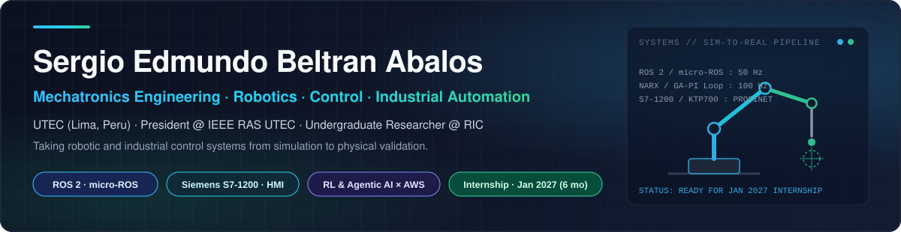
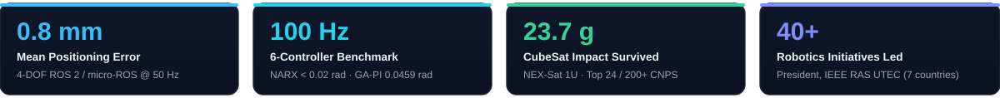
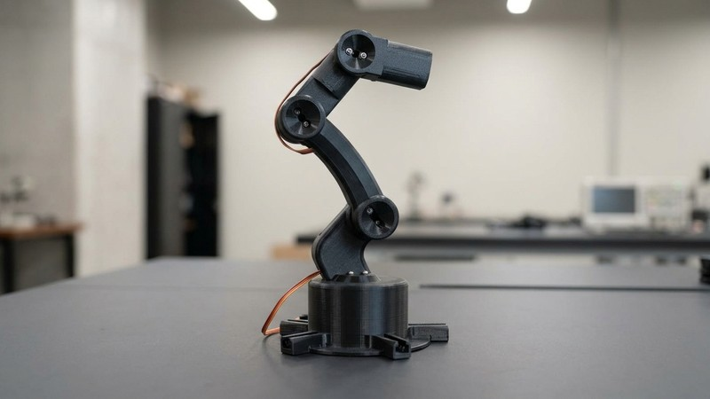
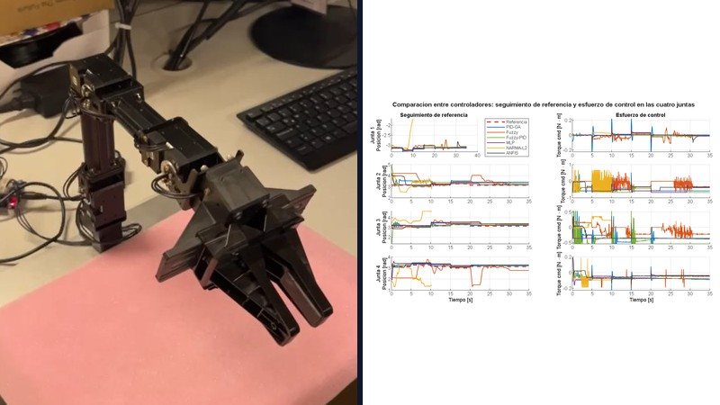
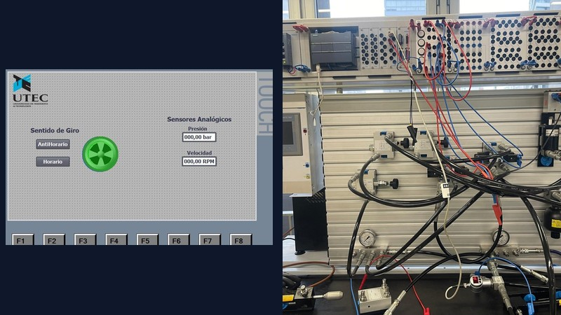
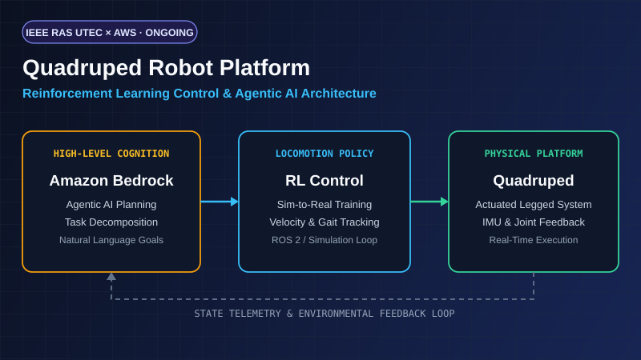
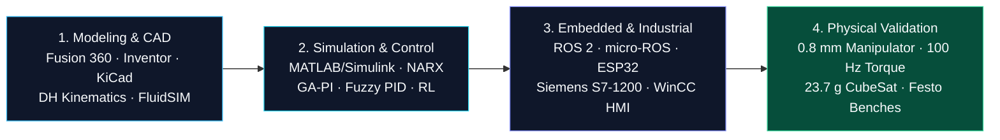

 

[-10B981?style=for-the-badge)](mailto:sergio.beltran@utec.edu.pe)

 

---

## Featured Engineering Portfolio

<table>
  <tr>
    <td width="50%" valign="top">
      
       
      <h3><a href="https://github.com/sergio-beltran-abalos/4dof-pcb-screwing-manipulator">4-DOF Manipulator for PCB Screwing</a></h3>
      

        
        
        
        
      

      
Owned high-level control: DLS inverse kinematics, quintic trajectories, RViz2 URDF digital twin, custom 2-layer PCB (ESP32 + 160 Hz RC filtering), and overhead computer vision.

    </td>
    <td width="50%" valign="top">
      
       
      <h3><a href="https://github.com/sergio-beltran-abalos/openmanipulator-x-intelligent-control">OpenMANIPULATOR-X — 6-Controller Study</a></h3>
      

        
        
        
      

      
Benchmarked 6 current-based joint controllers (GA-PI, Mamdani, Fuzzy PID, Imitation MLP, NARMA-L2, ANFIS) on NARX-identified dynamics and real Dynamixel X430 hardware with demo videos.

    </td>
  </tr>
  <tr>
    <td width="50%" valign="top">
      
       
      <h3><a href="https://github.com/sergio-beltran-abalos/plc-hmi-pneumatic-hydraulic-automation">Siemens S7-1200 PLC &amp; WinCC KTP700 HMI</a></h3>
      

        
        
        
      

      
TIA Portal Ladder logic (8-group cascades, TON/CTU, NORM_X/SCALE_X 0–10 V pressure &amp; RPM scaling), 2-screen PROFINET HMI, FluidSIM simulations, and physical Festo bench commissioning.

    </td>
    <td width="50%" valign="top">
      
       
      <h3><a href="https://github.com/sergio-beltran-abalos/nexum-1u-cubesat-validation">NEX-Sat — 1U CubeSat Qualification</a></h3>
      

        
        
        
      

      
Precision-agriculture 1U CubeSat (ESP32 + LoRa 433 MHz, 553 g). Led structural assembly, 100 Hz Arduino DAQ, thermal cycling (-1.5°C to 51.6°C), PSD vibration, and impact qualification.

    </td>
  </tr>
  <tr>
    <td width="50%" valign="top">
      
       
      <h3><a href="https://github.com/sergio-beltran-abalos/soft-robotic-rehab-glove-ric">Soft Robotic Rehab Glove (RIC UTEC)</a></h3>
      

        
        
        
      

      
Open-hardware post-stroke hand rehabilitation glove (Arduino + IRLZ44N MOSFETs + 3/2 NC solenoid valves + cast silicone actuators) engineered for future EEG Motor Imagery BCI integration.

    </td>
    <td width="50%" valign="top">
      
       
      <h3>Quadruped Robot — RL &amp; Agentic AI (Ongoing)</h3>
      

        
        
        
      

      
Leading, as President of IEEE RAS UTEC in collaboration with AWS, a quadruped robotics platform combining reinforcement learning locomotion control with high-level agentic reasoning via Amazon Bedrock.

    </td>
  </tr>
</table>

> **Also in my portfolio:** **Automated Assembly Plant** *(Factory I/O · Siemens S7-1200 Ladder · Festo pneumatic/vacuum & 1:30 three-phase motor sizing · complete Fusion 360 plant CAD)* and [**Aethera M5**](https://github.com/sergio-beltran-abalos/aethera-m5) *(Python · Gradio · LLM Guardrails hackathon project)*.

---

## How I Engineer Systems (Sim-to-Real Pipeline)

---

## Technical Stack

<strong>Robotics, Control &amp; AI</strong>

  
  
  
  
  
  
  

<strong>Programming &amp; Embedded Systems</strong>

  
  
  
  
  
  

<strong>Industrial Automation, Electronics &amp; CAD</strong>

  
  
  
  
  
  
  
  

---

## Research & Leadership

- **Undergraduate Researcher — RIC, UTEC** *(Apr 2025 – Present)*
  - Engineered the open electronic/pneumatic hardware for a [**post-stroke soft robotic rehabilitation glove**](https://github.com/sergio-beltran-abalos/soft-robotic-rehab-glove-ric) *(JOPICF 2026 Poster #1788455)*.
  - Contributed to a **PRISMA 2020 systematic review** (~40 studies) on parallel mechanisms for rehabilitation and assistance.
- **President — IEEE RAS UTEC** *(Jan 2026 – Present)*
  - Lead a **10-member board**; directed **RAS LATAM 2026** *(11 chapters & sections across 7 countries)* and **Battle RAS 2026** *(20 teams across Peru)*.
- **Director of Events & Institutional Image — IEEE RAS UTEC** *(2025)*
  - Led **40+ robotics & technology initiatives** for 100+ students across 6+ universities; recipient of the *IEEE RAS Peru Spirit & Commitment Award 2025*.

---

**Languages:** Spanish (Native) · English (Advanced — TOEFL ITP)

**Available for a 6-month pre-professional internship in Robotics, Control, or Industrial Automation starting January 2027.**

[sergio.beltran@utec.edu.pe](mailto:sergio.beltran@utec.edu.pe) · [LinkedIn](https://www.linkedin.com/in/sergio-beltran-abalos)

