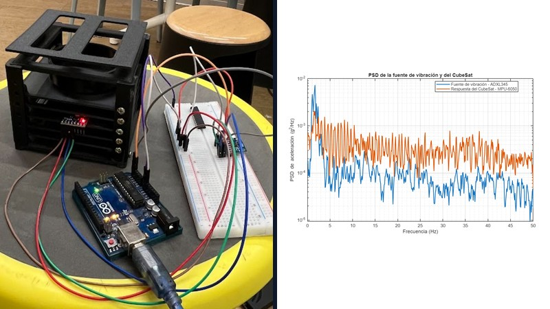
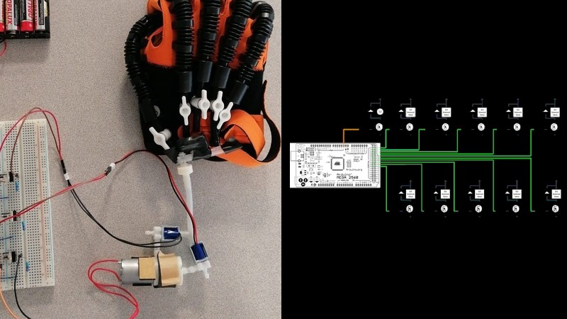

# Sergio Edmundo Beltran Abalos

**Mechatronics Engineering @ UTEC (Lima, Peru)** · Robotics, Control Systems & Industrial Automation  
Undergraduate Researcher @ **RIC (UTEC)** · President @ **IEEE RAS UTEC**

[LinkedIn](https://www.linkedin.com/in/sergio-beltran-abalos) · [Email](mailto:sergio.beltran@utec.edu.pe) · [4-DOF Robot Demo (YouTube)](https://youtube.com/shorts/tFkdfhnoOUY?feature=share) · *Available for a 6-month internship starting January 2027*

---

## Selected Projects

<table>
  <tr>
    <td width="46%" valign="middle">
      
    </td>
    <td width="54%" valign="top">
      <h3><a href="https://github.com/sergio-beltran-abalos/4dof-pcb-screwing-manipulator">4-DOF Serial Manipulator for PCB Screwing</a></h3>
      
Owned high-level control: architected <strong>ROS 2 Humble</strong> nodes with Damped Least Squares (DLS) inverse kinematics, quintic trajectories, an RViz2 URDF digital twin, and overhead OpenCV hole detection, bridged to ESP32 via <strong>micro-ROS at 50 Hz</strong>.

      
Integrated a custom 2-layer KiCad PCB (ESP32, H-bridge, 160 Hz RC analog feedback filtering) achieving <strong>0.8 mm mean error</strong> (2.0 mm max) and <strong>100% hole detection</strong>.

      
<a href="https://github.com/sergio-beltran-abalos/4dof-pcb-screwing-manipulator">Repository</a> · <a href="https://youtube.com/shorts/tFkdfhnoOUY?feature=share">Demo Video</a>

    </td>
  </tr>
</table>

<table>
  <tr>
    <td width="50%" valign="top">
      
      <h3><a href="https://github.com/sergio-beltran-abalos/openmanipulator-x-intelligent-control">OpenMANIPULATOR-X — 6-Controller Study</a></h3>
      
Benchmarked 6 current-based joint controllers (GA-PI, Mamdani Fuzzy, Fuzzy PID, Imitation MLP, NARMA-L2, ANFIS) at <strong>100 Hz</strong> on NARX-identified Dynamixel X430 dynamics (<strong>RMSE &lt; 0.02 rad</strong>) and physical hardware. GA-PI achieved <strong>0.0459 rad (2.6°)</strong> simulation RMSE.

      
<code>MATLAB/Simulink</code> · <code>NARX</code> · <code>GA-PI</code> · <code>Dynamixel X430</code>

    </td>
    <td width="50%" valign="top">
      
      <h3><a href="https://github.com/sergio-beltran-abalos/plc-hmi-pneumatic-hydraulic-automation">Siemens S7-1200 PLC &amp; WinCC KTP700 HMI</a></h3>
      
Programmed TIA Portal Ladder logic (SET/RESET sequencers, TON/CTU, 8-group cascades, <code>NORM_X</code>/<code>SCALE_X</code> <strong>0–10 V</strong> pressure &amp; RPM scaling) with a 2-screen PROFINET HMI, FluidSIM validation, and physical Festo bench commissioning.

      
<code>Siemens S7-1200</code> · <code>TIA Portal</code> · <code>WinCC KTP700</code> · <code>Festo</code>

    </td>
  </tr>
  <tr>
    <td width="50%" valign="top">
      
      <h3><a href="https://github.com/sergio-beltran-abalos/nexum-1u-cubesat-validation">NEX-Sat — 1U CubeSat Qualification</a></h3>
      
Assembled the 1U chassis (ESP32/LoRa 433 MHz, 553 g) and built a <strong>100 Hz Arduino DAQ</strong> (ADXL345, MPU6050, DS18B20) for thermal cycling (-1.5 °C to 51.6 °C), PSD vibration (<strong>5.19 g</strong>), and impact (<strong>23.7 g</strong>) tests with zero structural damage. <strong>CNPS Top 24 / 200+</strong>.

      
<code>ESP32 / LoRa</code> · <code>Arduino DAQ</code> · <code>PSD Vibration</code> · <code>CNPS</code>

    </td>
    <td width="50%" valign="top">
      
      <h3><a href="https://github.com/sergio-beltran-abalos/soft-robotic-rehab-glove-ric">Soft Robotic Rehab Glove (RIC UTEC)</a></h3>
      
Engineered the open <strong>10-channel</strong> electronic and pneumatic hardware (Arduino, IRLZ44N MOSFETs, 3/2 NC solenoid valves, cast silicone actuators) for post-stroke hand rehabilitation toward EEG-BCI integration. Presented at <strong>JOPICF 2026 (Poster #1788455)</strong>.

      
<code>Soft Robotics</code> · <code>10-Ch Pneumatics</code> · <code>Arduino</code> · <code>EEG-BCI</code>

    </td>
  </tr>
</table>

### Ongoing & Other Projects

- **Quadruped Robot Platform (IEEE RAS UTEC × AWS)** *(Ongoing)* — Leading development of a legged robotics platform combining reinforcement learning locomotion control with high-level agentic reasoning via Amazon Bedrock.
- **Automated Assembly Plant** — Conveyor and pick-and-place automation in Factory I/O with Siemens S7-1200 Ladder logic (including E-stop), Festo pneumatic/vacuum and 1:30 three-phase gearmotor sizing, and complete Autodesk Fusion 360 plant CAD.
- [**Aethera M5**](https://github.com/sergio-beltran-abalos/aethera-m5) — Non-clinical student orientation assistant built with Python, Gradio, and input/output LLM guardrails.

---

## Research & Leadership

- **Undergraduate Researcher — RIC, UTEC** *(Apr 2025 – Present)*
  - Engineered the open electronic/pneumatic architecture of the [post-stroke soft robotic rehabilitation glove](https://github.com/sergio-beltran-abalos/soft-robotic-rehab-glove-ric) (*JOPICF 2026 Poster #1788455*).
  - Contributed to a **PRISMA 2020 systematic review** (~40 studies) on parallel mechanisms for rehabilitation and assistance.
- **President — IEEE RAS UTEC** *(Jan 2026 – Present)*
  - Lead a **10-member board**; directed **RAS LATAM 2026** *(11 chapters/sections across 7 countries)* and **Battle RAS 2026** *(20 teams across Peru)*.
- **Director of Events & Institutional Image — IEEE RAS UTEC** *(2025)*
  - Led **40+ robotics & technology initiatives** for 100+ students across 6+ universities; recipient of the *IEEE RAS Peru Spirit & Commitment Award 2025*.

---

## Technical Stack

| Area | Tools & Technologies |
| :--- | :--- |
| **Robotics & Control** | ROS 2 Humble, micro-ROS, RViz2/URDF, Forward & Inverse Kinematics (DLS), Quintic Trajectories, PID / GA-PI / Fuzzy / ANFIS, NARX Identification, OpenCV, MATLAB/Simulink, AWS Bedrock |
| **Embedded & Software** | C/C++, Python, ESP32 (ESP-IDF), ATmega328P, Arduino, Raspberry Pi, Git, UART, I2C, SPI, PWM |
| **Industrial Automation** | Siemens S7-1200 PLC, TIA Portal, Ladder (LAD), `NORM_X`/`SCALE_X`, WinCC KTP700 HMI, PROFINET, Factory I/O, FluidSIM, Festo Electropneumatics & Electrohydraulics |
| **Electronics, CAD & Data** | KiCad (2-layer PCB), Autodesk Fusion 360, Autodesk Inventor, Power BI, Excel |

**Languages:** Spanish (Native) · English (Advanced — TOEFL ITP)
